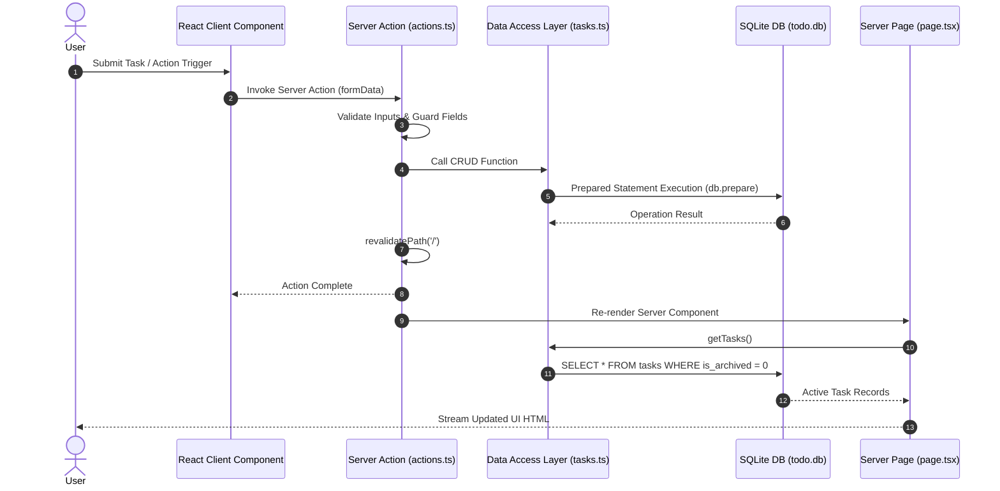

# COMS3011A Lab 1: Todo App

A local-first, single-user task management application built with Next.js App Router and SQLite (`better-sqlite3`).

---

## Project Description

This project provides a task management interface designed for desktop usage. It features task creation, real-time sorting by topic, status, and due date, dynamic overdue detection, task editing, and soft-deletion (archiving) with unarchiving capabilities.

---

## Architectural Choices & Key Decisions

1. Next.js App Router (Server Components & Server Actions):
   - Server Components execute on Node.js, allowing direct SQLite queries without separate REST API setup.
   - Server Actions handle form submissions securely on the server, eliminating client-side API boilerplate.
   - Server cache revalidation (`revalidatePath('/')`) keeps UI data in sync instantly after mutations.

2. SQLite via `better-sqlite3` (Local-First):
   - Synchronous, file-based database stored directly in `todo.db`.
   - Offers low latency and zero network dependencies.

3. Dynamic Overdue State Derivation:
   - Overdue status is computed dynamically at read-time by comparing `due_date` against the current date for non-completed tasks.
   - Overdue state is intentionally excluded as a database column to prevent stale data.

4. Soft-Deletion (Archiving):
   - Tasks are never hard-deleted from SQLite. Archiving sets `is_archived = 1`, preserving historical records while enabling restoration.

---

## System Architecture UML Diagram



---

## Third-Party Packages & Justifications

| Package Name | Type | Justification |
| :--- | :--- | :--- |
| `better-sqlite3` | Production | High-performance synchronous C-based SQLite driver for Node.js. |
| `@types/better-sqlite3` | Development | TypeScript type definitions for SQLite query compilation. |
| `next` | Production | Full-stack React framework providing App Router and Server Actions. |
| `react` / `react-dom` | Production | UI rendering engine for component tree management. |
| `tailwindcss` | Development | Utility styling engine for global baseline styles. |
| `typescript` | Development | Static type checking across server and client boundaries. |

---

## Environment Requirements & Running Instructions

### Requirements
- Node.js version 18.x or higher
- npm package manager

### Installation
```bash
npm install
```

### Running the Application
```bash
npm run dev
```
Note: Next.js defaults to port 3000. If port 3000 is occupied, Next.js automatically selects the next available port (e.g. 3001), or you can specify a custom port using `npm run dev -- -p <PORT_NUMBER>`.

---

## AI Usage Declaration

AI assistance was utilized during this project for architectural explanations, troubleshooting SQLite schema initialization, and reviewing TSX component patterns. All code additions were executed under guided pair-programming workflows.

Full session records and transcripts are declared in [docs/AI_TRANSPARENCY.md](docs/AI_TRANSPARENCY.md).

---

## Documentation Directory Index

All technical documentation modules are located inside the `docs/` folder:

- [Database Design Documentation](docs/DATABASE_DESIGN.md) - SQLite schema, column specifications, and design rationale.
- [Entity Relationships Documentation](docs/RELATIONSHIPS.md) - Class diagram, state transitions, and dynamic overdue rules.
- [AI Transparency Declaration](docs/AI_TRANSPARENCY.md) - AI usage breakdown, session transcripts, and prompt logs.
