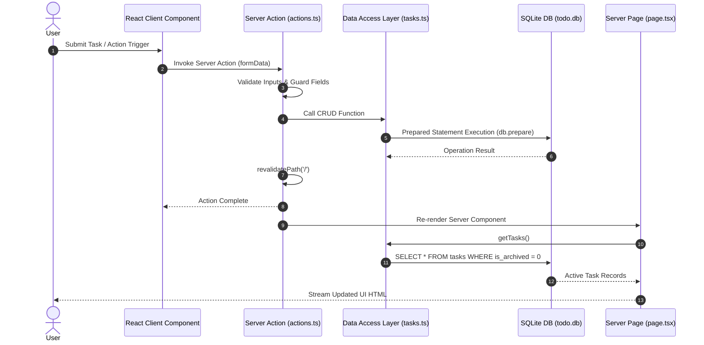

# COMS3011A Lab 1: Todo App

A local-first, single-user task management application built with Next.js App Router and SQLite (`better-sqlite3`).

---

## Project Description

This project provides a task management interface designed for desktop usage. It features task creation, real-time sorting by topic, status, and due date, dynamic overdue detection, task editing, and soft-deletion (archiving) with unarchiving capabilities.

---

## Step-by-Step Guide for Tutors and Evaluation Marking

Follow this explicit step-by-step guide to set up, reproduce, test, and run the project from scratch.

### Step 1: Verify Environment Prerequisites
Before running any commands, verify that Node.js (version 18 or higher) and npm are installed on your machine:

```bash
node -v
```
Expected output: `v18.x.x` or higher (e.g. `v20.x.x` or `v24.x.x`).

```bash
npm -v
```
Expected output: `9.x.x` or higher.

### Step 2: Clone and Navigate to the Repository
Open a terminal and clone the repository, then enter the project folder:

```bash
git clone https://github.com/mahlatseclayton/SDP_Lab_1_To-do-app.git
cd SDP_Lab_1_To-do-app
```

### Step 3: Install Dependencies
Install all required production and development dependencies specified in `package.json`:

```bash
npm install
```

If you are setting up the project manually from a clean environment without `package-lock.json`, you can install the specific packages using the individual commands below:

```bash
# Install core database engine
npm install better-sqlite3

# Install development types and tooling
npm install -D @types/better-sqlite3 @types/node @types/react @types/react-dom typescript eslint tailwindcss
```

### Step 4: Database Initialization
No manual database setup or SQL server configuration is required. 
- The application uses an embedded SQLite database stored locally in `todo.db`.
- When the application starts, `src/lib/db.ts` automatically initializes the `todo.db` database file and creates the required `tasks` table schema if it does not already exist.

### Step 5: Run Automated Unit Tests
To execute the automated unit test suite running against a throwaway in-memory SQLite database (`:memory:`), run the single test command below:

```bash
npm test
```

Expected output:
```text
✔ 1. Task Creation and Retrieval on throwaway in-memory SQLite database
✔ 2. Dynamic Overdue Calculation Rule (read-time comparison)
✔ 3. Task Archiving (Soft-deletion) and Unarchiving Verification
ℹ pass 3
ℹ fail 0
```

### Step 6: Start the Development Server
Launch the Next.js local development server:

```bash
npm run dev
```

Expected terminal output:
```text
▲ Next.js 16.2.12 (Turbopack)
- Local: http://localhost:3000
```

### Step 7: Open the Application in Your Browser
Open your web browser and navigate to:
```text
http://localhost:3000
```

Note on Port Fallbacks:
If port 3000 is already in use on your machine, Next.js will automatically select the next available port (e.g. `http://localhost:3001`). You can also specify a custom port explicitly using:
```bash
npm run dev -- -p 8080
```

---

## Architectural Choices & Key Decisions

1. Next.js App Router (Server Components & Server Actions):
   - Server Components execute on Node.js, allowing direct SQLite queries without separate REST API setup.
   - Server Actions handle form submissions securely on the server, eliminating client-side API boilerplate.
   - Server cache revalidation (`revalidatePath('/')`) keeps UI data in sync instantly after mutations.

2. SQLite via `better-sqlite3` (Local-First):
   - Synchronous, file-based database stored directly in `todo.db`.
   - Offers low latency and zero network dependencies.

3. Dynamic Overdue State Derivation:
   - Overdue status is computed dynamically at read-time by comparing `due_date` against the current date for non-completed tasks.
   - Overdue state is intentionally excluded as a database column to prevent stale data.

4. Soft-Deletion (Archiving):
   - Tasks are never hard-deleted from SQLite. Archiving sets `is_archived = 1`, preserving historical records while enabling restoration.

---

## System Architecture UML Diagram



---

## Third-Party Packages & Justifications

| Package Name | Type | Justification |
| :--- | :--- | :--- |
| `better-sqlite3` | Production | High-performance synchronous C-based SQLite driver for Node.js. |
| `@types/better-sqlite3` | Development | TypeScript type definitions for SQLite query compilation. |
| `next` | Production | Full-stack React framework providing App Router and Server Actions. |
| `react` / `react-dom` | Production | UI rendering engine for component tree management. |
| `tailwindcss` | Development | Utility styling engine for global baseline styles. |
| `typescript` | Development | Static type checking across server and client boundaries. |

---

## AI Usage Declaration

AI assistance was utilized during this project for architectural explanations, troubleshooting SQLite schema initialization, and reviewing TSX component patterns. All code additions were executed under guided pair-programming workflows.

Session records and JSONL log files are committed directly in the repository:
- [AI Transparency Declaration](docs/AI_TRANSPARENCY.md)
- [Compact Session Log (JSONL)](ai/transcript.jsonl)
- [Full Session Log (JSONL)](ai/transcript_full.jsonl)

---

## Documentation Directory Index

All technical documentation modules are located inside the `docs/` folder:

- [Database Design Documentation](docs/DATABASE_DESIGN.md) - SQLite schema, column specifications, and design rationale.
- [Entity Relationships Documentation](docs/RELATIONSHIPS.md) - Class diagram, state transitions, and dynamic overdue rules.
- [AI Transparency Declaration](docs/AI_TRANSPARENCY.md) - AI usage breakdown, session transcripts, and prompt logs.
