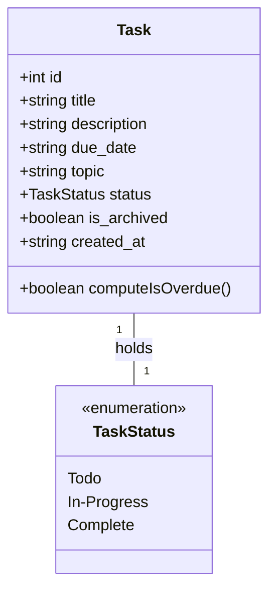
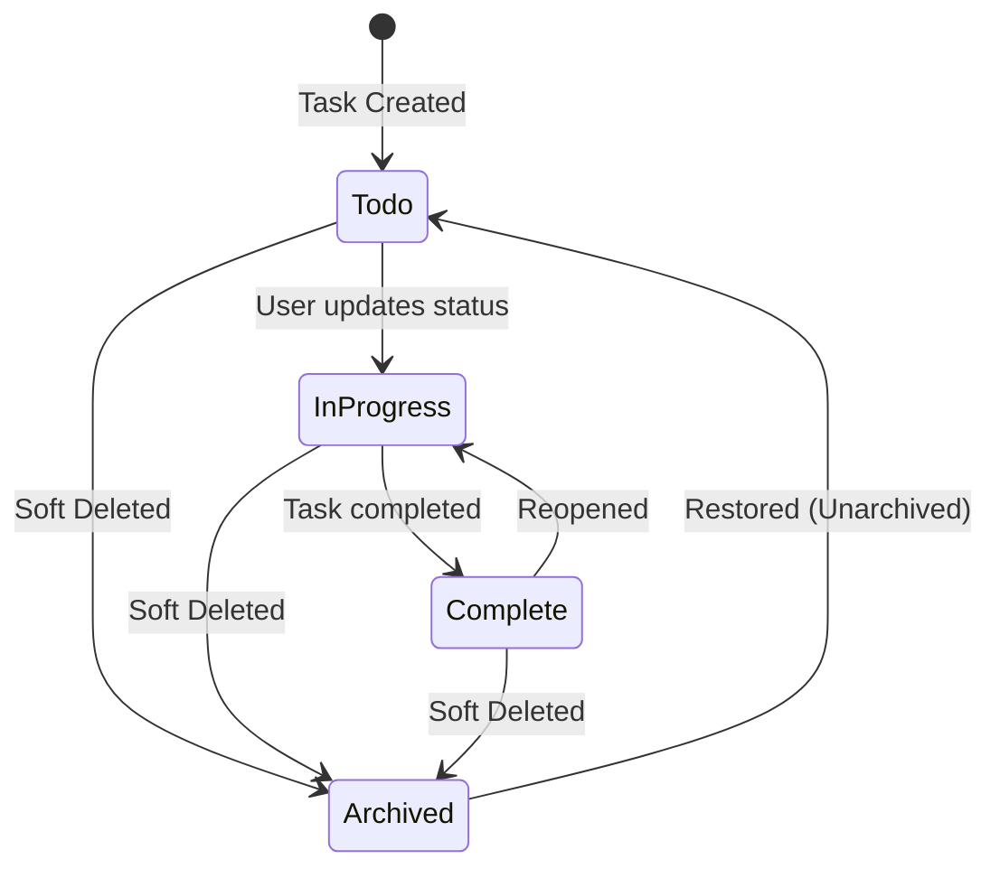

# Entity Relationships and Data Lifecycle

## System Architecture Model

The application operates as a single-table relational model optimized for local-first desktop usage.

## State Transitions & Task Lifecycle

A task record moves through defined state transitions:

## Overdue Derivation Logic

Overdue state is derived dynamically at query runtime using the following logic:

- Condition 1: `status !== 'Complete'`
- Condition 2: `due_date < current_date` (ISO format `YYYY-MM-DD`)

If both conditions are met, `is_overdue` evaluates to `true`. Completed or archived tasks are never marked as overdue.
